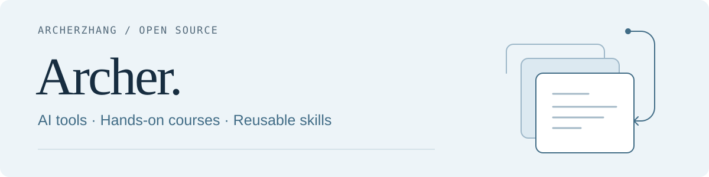

<picture>
  <source media="(prefers-color-scheme: dark)" srcset="./assets/profile-header-dark.svg">
  <source media="(prefers-color-scheme: light)" srcset="./assets/profile-header.svg">
  
</picture>

### 把 AI 用进实际工作，把方法留下来。

Hi, I'm **Archer**. I build practical AI tools and share the methods behind them.

我在维护一组 AI 工具、实践课程和可复用的 Skill：让 Agent 接入日常工作，让同事能动手练习，也让上下文、任务进度和经验延续到下一次工作。

[**AI 实践课程 ↗**](https://archer-ai-courses.pages.dev/) · [**Thunderbird 邮件 MCP**](https://github.com/zhangjian0410/thunderbird-mail-mcp) · [全部仓库](https://github.com/zhangjian0410?tab=repositories)

## 工具、上下文与经验复用

| 项目 | 用它做什么 |
| :--- | :--- |
| [**Thunderbird Mail MCP**](https://github.com/zhangjian0410/thunderbird-mail-mcp) | 连接本机 Thunderbird，查询收件箱与已发送邮件、读取附件、保存草稿，以及执行明确获授权的发送。原生部署面向 macOS。 |
| [**Context Infrastructure**](https://github.com/zhangjian0410/context-infrastructure) | 用可编辑的 Markdown 组织背景与个人记忆，按任务读取相关资料。 |
| [**Task Checkpoint Handoff**](https://github.com/zhangjian0410/task-checkpoint-handoff) | 保存未完成工作的目标、文件与证据，让新的 Agent 会话接续任务。 |
| [**Learning from Work**](https://github.com/zhangjian0410/learning-from-work) | 从任务材料中提炼有来源的经验、开放问题和改进建议。 |

## 课程与学习资料

从 [**课程总入口**](https://archer-ai-courses.pages.dev/) 选择主题。课件、跟练和下载资料使用同一套课程导航。

| 项目 | 内容与学习入口 |
| :--- | :--- |
| [**Skill Engineering Guide**](https://github.com/zhangjian0410/skill-engineering-guide) | 从 Chat 中完成一次任务，到提炼、安装和复用 Skill；配套跟练、进阶练习与自评。[开始学习 ↗](https://archer-ai-courses.pages.dev/courses/skill-engineering/) |
| [**Agentic Loop Course**](https://github.com/zhangjian0410/agentic-loop-course) | 用 Qoder 做工作日 API、聊天界面与工具调用循环，搭建第一个 AI Agent。[开始学习 ↗](https://archer-ai-courses.pages.dev/courses/agentic-loop/) |
| [**千问办公 · 基础篇**](https://github.com/zhangjian0410/qwenwork-basics-course) | 从对话走向 Office 成品，配套课件、动手任务与自测。[开始学习 ↗](https://archer-ai-courses.pages.dev/courses/qwen-office-basics/) |
| [**千问办公 · 进阶篇**](https://github.com/zhangjian0410/qwenwork-advanced-course) | 练习分步执行、网页交付、数据源与技能编排，从个人使用走向团队复用。[开始学习 ↗](https://archer-ai-courses.pages.dev/courses/qwen-office-advanced/) |
| [**AI Training Portal**](https://github.com/zhangjian0410/ai-training-portal) | 四门课程的统一目录、组装发布与共享交流后台。[浏览课程 ↗](https://archer-ai-courses.pages.dev/) |

课程欢迎在站内交流；项目问题与改进建议，请到对应仓库的 Issues。具体使用条件与验证范围以各项目 README 为准。
